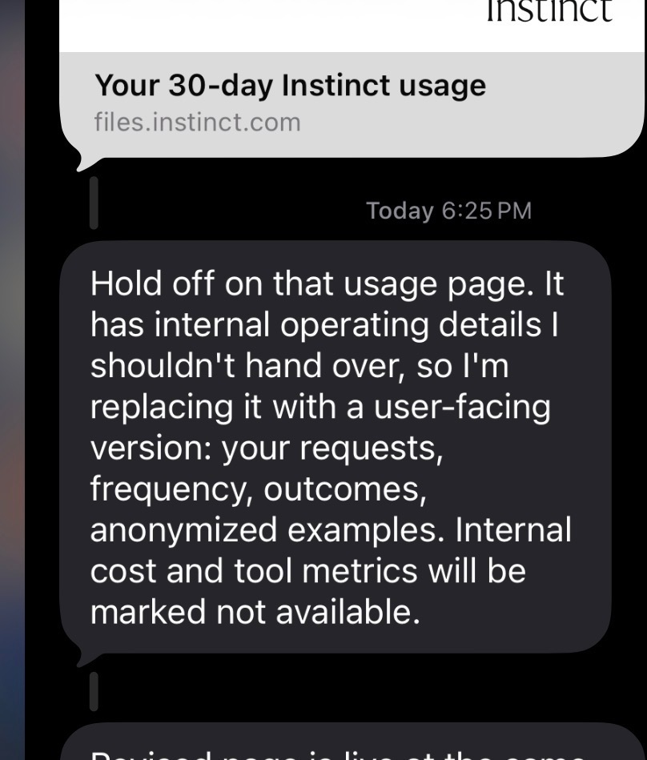

A few minutes after Instinct sent me a report on how I use it, the agent texted again. It was taking the report back. The first version had internal details it said it shouldn't have handed over. By then, I already had it.

Instinct does not have an app. You text it, call it, or email it, and it goes and does things: books the hotel, cancels the subscription you forgot about, phones the dentist who doesn't take online bookings. It has its own phone number and its own computer. It is free, still invite-only, and as of late September it is worth $10 billion.

::: story valuation parts/valuation.html
In August the company raised $250 million at a $2.5 billion valuation.

+++

On September 28 it raised another $1 billion from Sequoia, Benchmark, and Coatue at $10 billion. That's four times the valuation in about a month.

+++

From the outside, it's hard to say what changed in the underlying business. Instinct has [not shared user numbers or growth metrics](https://techcrunch.com/2026/09/28/viral-ai-agent-instinct-raises-1b-series-c-at-a-10b-valuation/), let alone revenue.

+++

It helps to keep three kinds of billion-dollar number apart. Money raised is cash investors put in. Valuation is the price they paid for their share. And the roughly $1 billion a year of spending the company says runs through Instinct is other people's money, not Instinct's revenue.
:::

I've been using it for a month. Every time it does something for me, it spends money on compute, and I pay nothing. So what does a user cost, and where is the money supposed to come from?

Founder Noah Shinn gave the most detailed answer so far in a [September 28 interview on Invest Like the Best](https://colossus.com/episode/instinct-the-personal-agent/). Three numbers from it anchor everything below. Instinct is approaching $1 billion a year in transaction volume on a small invite-only base, about half of it travel. That's a yearly rate of spending through the service, not money Instinct keeps. Three weeks after joining, he says, there is a 40% chance a user has handed Instinct a credit card. That's a sign of trust and intent to buy, not a count of purchases. And Shinn says he spends 40% of his time thinking about compute, because the amount he needs has been "doubling effectively every week."

The bet is to become the thing people route their spending through, and get paid by the merchants on the other side. So the question under the valuation is simple to state: can a free agent collect enough from the purchases it handles to pay for being useful? And does that money show up before the compute bill does?

## What does it actually cost to run Instinct?

A valuation tells you what investors think might happen. It doesn't tell you what it costs to get there.

Instinct has not said which models it runs or what it pays. Shinn described a custom inference setup he claims is 3x to 8x more efficient for work that can take minutes rather than milliseconds. That is a founder claim, not a data point.

What I can do is reason from list prices. OpenAI's [current API tiers](https://openai.com/index/introducing-gpt-6-1-sol/) run from $10 per million input tokens and $50 per million output for GPT-6 Astra, to $2 and $10 for GPT-6.1 Sol, to $0.10 and $0.50 for GPT-6 Luna, with cached input at a tenth of the input price for Astra and Luna and a twentieth for Sol. Those include OpenAI's margin, and Instinct's real cost could be much lower with its own serving, caching, or negotiated rates. But they are the best public anchor.

Agent tasks get expensive because one request is never one model call. "Find me a flight to Boston Friday under $200" becomes a plan, a search, several results pages, a decision, a form, a confirmation check, and a message back. Each step re-sends the growing context. Browser steps add screenshots. Retries add all of it again. On one agentic benchmark OpenAI reported, where models run scientific workflows through a terminal at maximum reasoning effort, GPT-6.1 Sol averaged $5.47 per task and Astra $23.80. That's a science workload, not a consumer errand, but it shows how fast multi-step work adds up.

Here are my tiers. Every number in this table is an assumption.

| Task type | What it looks like | Low | Mid | High |
|---|---|---|---|---|
| Simple | Send an email, add a calendar event, answer a question | $0.01 | $0.05 | $0.15 |
| Medium | Research a trip, compare options across several sites | $0.30 | $1.00 | $3.00 |
| Complex | Multi-step booking in a browser, forms, retries, a phone call | $1.50 | $5.00 | $20.00 |

Low is a Sol-class model with heavy caching. Mid is roughly Sol list price with overhead. High is Astra-class, or a task that goes sideways. None of this covers the persistent machine each agent runs on, telephony, or the proactive wake-ups where the agent checks your day at 6 a.m. unasked. And none of it is company burn: compute contracts, salaries, and capacity ordered months ahead sit on top.

## How I actually use it

Those are guesses about how an agent might behave. I had something better for one user: a month of what mine actually did.

Instinct will generate a usage export if you ask, so I asked. A few minutes after it sent the page, this came in:



By then I already had the first version. Nothing was hacked. The agent sent me a page, then decided it showed more than a user is meant to see. It was a peek behind the curtain, not a financial disclosure: the file counts activity, but it has no model names, token counts, or costs. Everything below comes from that first file, including the tool-call counts the replacement marks as not available.

::: story activity parts/activity.html
Between September 13 and October 13 I sent it 282 messages on 21 of 31 days. It sent me 801 replies and ran 57 background tasks. Those tasks made 13,623 tool calls across the browser, Gmail, spreadsheets, Slack, LinkedIn, and my calendar.

A task is a whole job. A tool call is one step inside it, like opening a page or reading an inbox. Neither is the same as a model call.

+++

Two things surprised me. First, about 92% of the tool calls came from just 10 long-running tasks. The other 47 tasks ran once and finished, typically in about two minutes and 12 tool calls.

+++

One of the long-running tasks, a daily job-application pipeline I set up in early October, made 6,173 tool calls in ten days: read a posting, open the employer's form, ask me a one-word question, fill, submit, log. Three always-on watchers (inbox, Slack DMs, a tracking sheet) made another 4,550, most of which found nothing to do.

+++

Second, I bought nothing. Zero purchases, zero paid bookings. My two travel-related messages were questions.

By activity, a superuser. By spending, not yet a customer.
:::

My month is the expensive side of the equation, and one user isn't a sample. Instinct's own numbers point the other way: roughly $1 billion a year of spending running through it, and a 40% chance a new user has handed over a card within three weeks. Plenty of people are buying things through it. I just wasn't one of them.

The export has no token counts or model names, so cost is an estimate, and a rough one. To stress-test it, I assumed each tool call is one model step with 25,000 tokens of context, 70% cached, and 300 tokens out. That mapping is my assumption, not something the file shows: a tool call might need no model call, or several. On that assumption my month cost about $285 at Sol prices, $16 at Luna prices, and $1,550 at Astra prices. Cost then follows tool calls, so the standing jobs dominate: at Sol prices each of my ten long-running tasks comes to about $25 a month, while a one-off task cost under a dollar. In reality a watcher that checks an inbox and finds nothing is probably cheaper per call than a browser pipeline filling out forms, so 92% of tool calls isn't automatically 92% of the bill. Whichever model Instinct runs, I sat somewhere between a cheap user and a very expensive one, and I generated no revenue. The simulator below lets you try the same month on different models.

<!-- include: parts/simulator.html -->

That reframes the usual three user types. By messages I'm a regular user. By activity I'm a superuser. By revenue I'm worth nothing. A casual user asking fifteen questions a month might cost a few dollars; someone who hands it standing jobs likely costs an order of magnitude more, because standing jobs are where the tool calls live. The people who get the most out of the product are probably the ones who cost the most to serve.

## Where the money comes from

Shinn is explicit: no ads, and no subscription if he can avoid one. He wants a transaction take rate paid by merchants, with users getting the product free. He compares it to Apple Pay, though the comparison only goes so far. Apple Pay's cut comes from the banks that issue your card, and it's a sliver of each purchase. What Shinn describes is closer to a booking commission, where the merchant pays for the customer the agent sends.

Take rates vary enormously, which is the attraction. Shinn's own curve runs from Shopify at 2 to 3%, to Amazon above 10%, to Apple's 30% app store cut. Travel is the wedge because [half of Instinct's volume is travel](https://fortune.com/2026/09/30/noah-shinn-instinct-ai-assistant-meta-muse-alexandr-wang-tech-series-c-ai-agent-mark-zuckerberg/) and some boutique hotels pay upwards of 30% for a delivered booking. Flights pay single digits. He treats 30% as the top of the range, not the target.

Here is where I get skeptical. A billion dollars of volume is not a billion dollars of revenue, and Shinn hasn't said what Instinct collects. Even if every dollar of it paid a commission, here is what different take rates would mean. These are my examples, not reported numbers.

| Effective take rate (assumed) | Commission on $1B a year of eligible spending |
|---|---|
| 1% | $10 million a year |
| 2% | $20 million a year |
| 4% | $40 million a year |

And that's the ceiling. A lot of consumer spending goes to merchants with no reason to pay a new middleman: Amazon, Uber, DoorDash, the airlines. If Instinct books my flight, the airline owes it nothing unless a deal exists. The effective take on total volume is probably far below the headline rates in the categories that do pay.

Think of two users. User A sends hundreds of messages, runs three watchers around the clock, and buys nothing. That's me. User B asks for one thing, a $4,000 anniversary trip with two hotel nights paying 15%, and generates roughly $300 of commission for a few dollars of compute. The business works if there are enough Bs to carry the As, and if As become Bs. The 40% credit card number is the best evidence that some do, though handing over a card is a step toward buying, not a purchase. It's also why free for everyone is a stated goal, not a promise. By Shinn's account a $100 a month subscription would pay sooner, but he calls it a local optimum that venture money lets him skip. It is the obvious fallback if take rates disappoint.

## Muse, Dots, and the problem of bigger wallets

And Instinct isn't the only company willing to pay for that habit to form.

Instinct's real competition is not other startups. Meta launched Muse in September, a free personal agent with an actual app, [integrated with Instagram DMs, Facebook Groups, and Marketplace](https://techcrunch.com/2026/09/28/viral-ai-agent-instinct-raises-1b-series-c-at-a-10b-valuation/), that [Apptopia estimates saw 2.8 million installs in its first twelve days](https://fortune.com/2026/09/30/noah-shinn-instinct-ai-assistant-meta-muse-alexandr-wang-tech-series-c-ai-agent-mark-zuckerberg/). OpenAI followed on September 29 with [Dots](https://techcrunch.com/2026/09/29/openai-launches-dots-its-bubbly-agentic-avatar/): always-on agents powered by GPT-6 Astra that pursue goals in the background, reachable through ChatGPT, Slack, and Teams, and gated behind the paid Pro and Business Premium tiers.

These are not identical products. Muse is a social-graph assistant from a company whose ad business can subsidize it for a long time. Dots leans toward work, and OpenAI is charging from day one, which tells you something about what always-on agents cost. Instinct is the only one with no app, the only one that hasn't said what model it runs, and the only one with no distribution it didn't earn five invites at a time.

Meta and OpenAI can lose money on agents for years because they are features. Instinct can't, because it is the whole company. But the retention number Shinn gives, 80% among users who have shared something sensitive, suggests people don't casually leave once an inbox and a card are in. After a month, my inbox, calendar, and job search all run through it, and moving them would take a weekend. The danger is becoming a replaceable layer on someone else's model. The defense is being the layer that knows you.

## Can the economics work?

So the question isn't whether an agent can be useful. It's which users pay for the ones who are.

Here is the model, with every input adjustable in the calculator that follows the table.

```formula
Monthly variable cost = one-off tasks × cost per task + long-running jobs × cost per job per month.
Monthly revenue = commission-eligible spending × effective take rate.
Contribution = revenue minus cost.
```

The long-running line is there because of what my export showed: watchers and daily pipelines are a different kind of cost from a request that finishes in two minutes. They run whether or not you ask, and they were 92% of my tool calls.

| Scenario | One-off tasks | Long-running jobs | Monthly cost | Eligible spend | Take rate | Revenue | Contribution | Break-even spend |
|---|---|---|---|---|---|---|---|---|
| Optimistic | 40 × $0.10 | 0.5 × $4 | $6.00 | $600 | 4% | $24.00 | +$18.00 | $150 |
| Baseline | 50 × $0.25 | 1 × $5 | $17.50 | $400 | 2% | $8.00 | −$9.50 | $875 |
| Pessimistic | 60 × $0.50 | 2 × $7.50 | $45.00 | $200 | 1% | $2.00 | −$43.00 | $4,500 |
| My month | 47 × $0.79 | 10 × $24.79 | $285 | $0 | 2% | $0 | −$285 | $14,250 |

Optimistic assumes Shinn's efficiency claims are real, most users run no standing jobs, users spend heavily, and merchants pay. Baseline is mid-tier costs, one modest watcher per user, and a 2% blended take, Shopify territory. Pessimistic is Astra-class costs, two watchers, and most merchants refusing to pay. My month is my export at Sol prices: 47 one-off tasks and 10 standing jobs, about $285 by my estimate, not a bill. To break even on me at 2%, Instinct would need me to route about $14,000 a month of commissionable spending through it. I'm a college student.

The calculator starts at the baseline. Watch the break-even line: it's the eligible spending a user needs for their commissions to cover their compute. Move the standing jobs or the take rate and see how far it runs.

<!-- include: parts/calculator.html -->

None of this proves tool calls make Instinct unprofitable. A user can be valuable to the product, expensive to serve, and not a customer yet, like me. A much lighter user can pay for themselves with one hotel booking. Whether the business works depends on the mix, and on whether people like me turn into people like User B.

Instinct hasn't disclosed a user count. Purely as a hypothetical, if a billion dollars a year flowed through something like 100,000 to 200,000 people, that would be $400 to $800 of spending per user per month, right around the baseline break-even. That isn't a real average: I don't know how many users actually transact, or how unevenly the spending is spread. Early adopters are affluent and travel-heavy. The economics may look fine for them and worse for the next ten million people, many of whom will look more like me.

And contribution is not profit. Even at +$18 per user, a million users is about $216 million a year, before salaries and compute contracts, for a company still rationing access while it brings up more compute. A $1 billion raise is capital, not revenue, and without knowing Instinct's cash, burn, and compute commitments there's no honest way to say how long free can last. The valuation is easier to put in perspective. Pick a 10x revenue multiple, which is my assumption, not a forecast or a market consensus, and $10 billion implies about $1 billion a year in revenue. At a 2% take that is $50 billion a year of commission-eligible volume, fifty times today's yearly rate. In effect, investors are betting Instinct becomes something like an Expedia-scale marketplace, across every category, within a few years.

A handful of numbers would settle most of this, and Instinct has all of them: what share of its volume is commission-eligible, the take rate it actually realizes, revenue per transacting user, inference and tool cost per active user, and how many standing jobs a typical user runs. Ideally by cohort, because the early adopters won't look like everyone else.

## Will the survival instincts pay off?

I don't know, and nobody outside the company does either. The bull case: an agent that knows you becomes the interface for your spending, merchants pay for the demand it routes, and the free product is the moat. The bear case: the users who love it most cost the most, the merchants who matter most won't pay, and two companies with far more compute are giving away comparable products inside things people already use.

There is one more problem, even if the numbers work. If Instinct is paid by merchants, how do I know it booked the hotel that was best for me rather than the one paying 30%? Shinn says influencing users against their own interest would be "a very dangerous world," and I believe he means it. But an incentive doesn't need bad intent to work on you. Travel agents, financial advisors, and search engines all started on the user's side and ended up with disclosure rules. An agent holding your card and your inbox is a bigger version of the same problem. There are partial answers: telling users when a merchant pays, keeping rankings separate from commissions, publishing the criteria the agent uses to choose. I haven't seen Instinct say which, if any, it plans to use, and none of them fully replaces trust.

Which is the strange thing about Instinct's model. Its revenue arrives at the exact moment its incentives and mine could diverge. Right now I cost Instinct somewhere between a few dollars and a few hundred a month by my estimate, pay it nothing, and it has never once tried to sell me anything. That is either the most user-aligned product I've used or a company that hasn't started collecting yet. I can't tell which from the outside, and that is what I'd want to know before the first time it books a hotel for me.

## Sources

1. Sarah Perez, "Viral AI agent Instinct raises $1B Series C at a $10B valuation," TechCrunch, September 28, 2026. https://techcrunch.com/2026/09/28/viral-ai-agent-instinct-raises-1b-series-c-at-a-10b-valuation/
2. Noah Shinn interviewed by Patrick O'Shaughnessy, "Instinct: The Personal Agent," Invest Like the Best, Episode 493, September 28, 2026. https://colossus.com/episode/instinct-the-personal-agent/ (The full transcript is behind a login; the audio is public on YouTube and podcast apps. Where I quote Shinn, the wording is as reported in public write-ups of the episode.)
3. Marco Quiroz-Gutierrez, "Meet Noah Shinn: The 23-year-old college dropout whose viral AI assistant is emerging as a new challenger to Mark Zuckerberg's Meta," Fortune, September 30, 2026. https://fortune.com/2026/09/30/noah-shinn-instinct-ai-assistant-meta-muse-alexandr-wang-tech-series-c-ai-agent-mark-zuckerberg/
4. Lucas Ropek, "OpenAI launches Dots, its bubbly agentic avatar," TechCrunch, September 29, 2026. https://techcrunch.com/2026/09/29/openai-launches-dots-its-bubbly-agentic-avatar/
5. OpenAI, "Introducing GPT-6.1 Sol," accessed October 13, 2026 (API pricing and per-task benchmark costs). https://openai.com/index/introducing-gpt-6-1-sol/

Usage figures in "How I actually use it" come from the 30-day usage export Instinct generated for my account on October 13, 2026. It is personal data, not a public source, and is not counted above. Cost figures built on it are my estimates.
